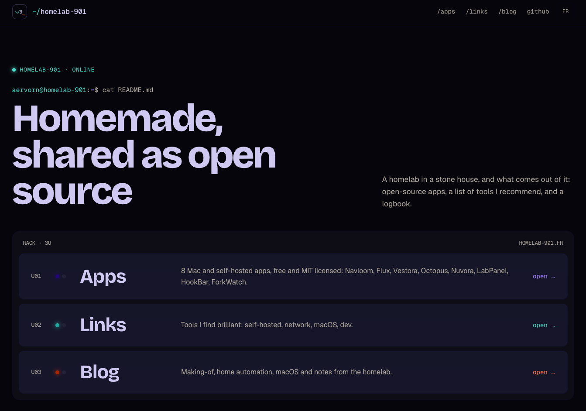

# Hi, I'm Aervorn 👋

### Automation · Smart home · Homelab

  
  
  
  

I started my career in software development, then moved into automation and orchestration. AI helps me explore ideas beyond my current skill set and get from concept to working software faster.

I build these apps for myself first. If they help someone else along the way, even better.

## What matters to me

- **Open source**
- **Completely free**
- **No telemetry**
- **Actively maintained** — I’m the first user of my own projects

## Website

On my website, I showcase my projects and share tools I use and enjoy (some I wish I’d discovered much sooner 😄). I also hope to publish a few useful articles when time allows.

🌐 [homelab-901.fr](https://www.homelab-901.fr)

## Enjoyed a project?

I don’t accept sponsorship. If something I made is useful to you, leaving a star :star: always makes my day. And if you’d like to adapt a project, feel free to fork it and make it your own.
